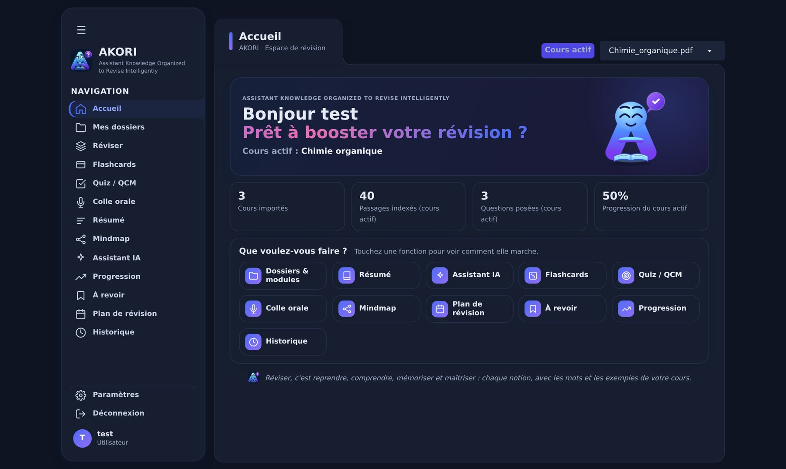
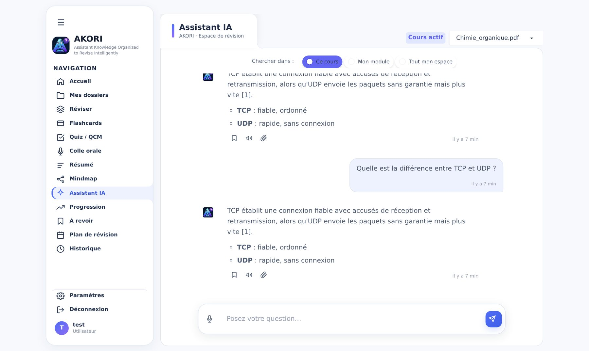
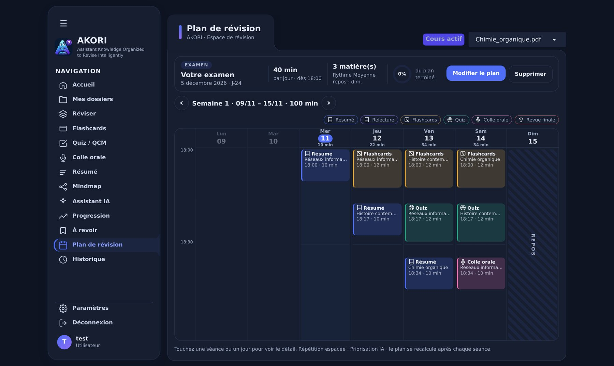
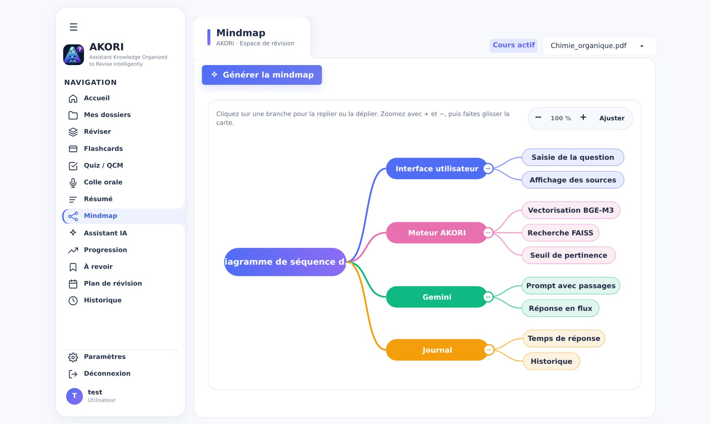
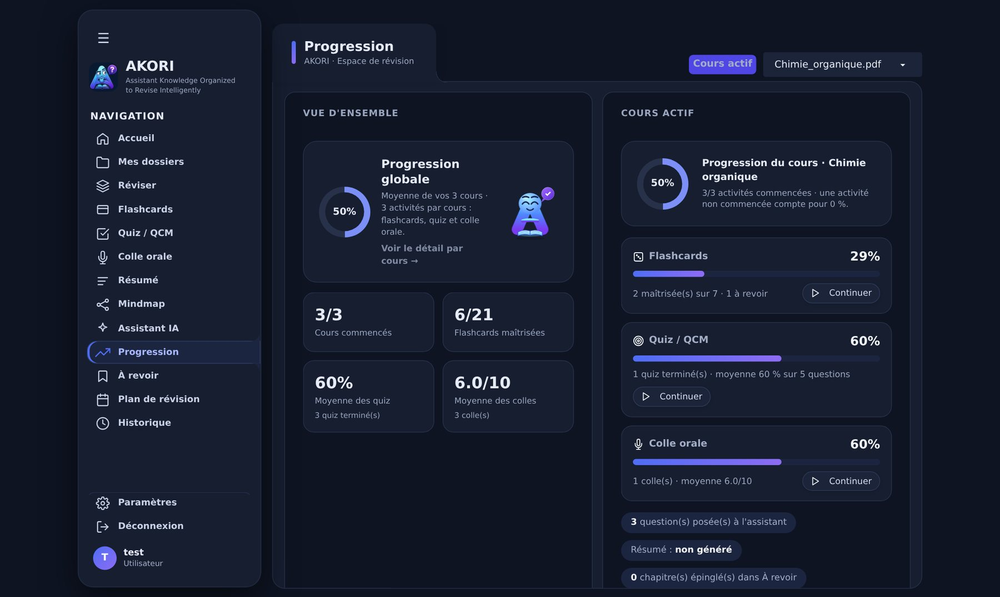

# AKORI — Assistant Knowledge Organized to Revise Intelligently

AKORI est un assistant de révision qui travaille **uniquement à partir des cours de l'étudiant**. On importe ses PDF (même scannés) ; AKORI les indexe page par page, répond aux questions en citant les pages utilisées, et transforme le cours en activités de révision : flashcards, quiz, colle orale, carte mentale, résumé et plan de révision jusqu'à l'examen.

Projet de fin d'études — Licence professionnelle en Génie Informatique, Institut Supérieur des Sciences et Technologies de Mahajanga (ISSTM), 2025–2026. Auteure : Nomeniavo Edm-Johana RAFALIMANANA.



## Sommaire

1. [Fonctionnalités](#fonctionnalités)
2. [Captures d'écran](#captures-décran)
3. [Comment ça marche (architecture RAG)](#comment-ça-marche-architecture-rag)
4. [Lancer AKORI](#lancer-akori)
5. [Configuration](#configuration)
6. [Structure du dépôt](#structure-du-dépôt)
7. [Mesures et rapport](#mesures-et-rapport)

## Fonctionnalités

| Fonction | Ce qu'elle fait |
|---|---|
| **Assistant IA** | Répond à partir des passages du cours, cite ses sources (page, section), refuse de répondre si l'information est absente du cours. Recherche dans un cours, un module ou tout l'espace. |
| **Flashcards** | Au moins 7 cartes en mode roulette ; « Je savais » / « À revoir » alimentent la progression. |
| **Quiz (QCM)** | 5 questions corrigées au toucher, avec explication ; les erreurs repèrent les notions fragiles. |
| **Colle orale** | Question ouverte, réponse écrite ou dictée, note sur 10 et page à relire. |
| **Mindmap** | Carte mentale du cours, branches repliables, zoom et déplacement. |
| **Plan de révision** | Assistant en 5 étapes (contexte, calendrier, matières, rythme, fonctions IA) puis emploi du temps semaine par semaine, avec répétition espacée et alertes de surcharge. |
| **Progression et historique** | Avancement par cours (flashcards, quiz, colle orale), journal des séances, carte des lacunes. |
| **Comptes** | Espace isolé par utilisateur, mots de passe chiffrés (PBKDF2-SHA256), console d'administration. |
| **Partout** | Ordinateur et téléphone, thème clair ou sombre, français ou anglais, PDF scannés (OCR). |

## Captures d'écran

| Assistant (réponses sourcées) | Plan de révision (emploi du temps) |
|---|---|
|  |  |
| **Mindmap** | **Progression** |
|  |  |

D'autres captures (page de présentation, quiz, assistant du plan, version téléphone) sont dans [`rapport/images/annexe/`](rapport/images/annexe/).

## Comment ça marche (architecture RAG)

```
PDF ──► PyMuPDF (+ OCR Tesseract pour les pages scannées)
    ──► découpage par page : fragments de 800 caractères, chevauchement de 80, page et section conservées
    ──► BGE-M3 (vecteurs normalisés de dimension 1024) ──► index FAISS (un par cours, enregistré sur disque)

Question ──► BGE-M3 ──► FAISS : les 4 passages les plus proches
         ──► seuil de pertinence (similarité cosinus < 0,30 : « l'information ne figure pas dans le cours »)
         ──► Gemini (gemini-3.5-flash-lite, modèles de secours automatiques) ──► réponse en flux + sources
```

La recherche s'exécute dans l'application ; seule la rédaction est confiée à l'API Gemini, avec la question et les passages retenus.

## Lancer AKORI

Il faut une clé d'API Gemini (gratuite sur [Google AI Studio](https://aistudio.google.com/apikey)).

| Où | Commande |
|---|---|
| **Google Colab** | Mettre la clé dans les secrets Colab (`GEMINI_API_KEY`), puis exécuter `akori.py`. Un lien public `gradio.live` s'affiche ; les données sont enregistrées sur Google Drive. Activer un GPU accélère l'indexation. |
| **PC ou serveur** | `pip install -r requirements.txt` puis `GEMINI_API_KEY=... python akori.py` → http://localhost:7860 |
| **Docker** | `docker build -t akori .` puis `docker run -p 7860:7860 -v akori:/data -e GEMINI_API_KEY=... -e AKORI_ADMIN_PASSWORD=... akori` |

Préparer les cours à l'avance (indexation et contenus de révision générés une fois) : `python akori.py --build --pdfs dossier_des_pdf --user compte@exemple.com`.

### Déployer pour tout le monde : Hugging Face Spaces

1. Sur huggingface.co : **New Space** → SDK **Docker** → *Blank*, puis envoyer ce dépôt dans le Space (ou le connecter à GitHub).
2. **Settings → Variables and secrets** : ajouter `GEMINI_API_KEY` et `AKORI_ADMIN_PASSWORD` (sinon un mot de passe aléatoire est écrit dans les *logs*).
3. **Données persistantes** : activer *Persistent storage* (monté sur `/data`), ou, gratuitement, ajouter les secrets `HF_TOKEN` (jeton avec droit *Write*) et `AKORI_HF_DATASET` (par ex. `compte/akori-data`) : AKORI sauvegarde alors comptes, cours et progression dans ce dépôt privé et les restaure au redémarrage.
4. L'adresse `https://<compte>-akori.hf.space` s'ouvre sur n'importe quel téléphone ; « Ajouter à l'écran d'accueil » crée une icône AKORI.

## Configuration

| Variable | Rôle |
|---|---|
| `GEMINI_API_KEY` | Clé Gemini (obligatoire pour les réponses). `GEMINI_API_KEYS` : plusieurs clés séparées par des virgules. |
| `AKORI_ADMIN_PASSWORD` / `AKORI_ADMIN_USER` | Mot de passe de l'administrateur / compte existant à promouvoir administrateur. |
| `AKORI_DATA_DIR` | Dossier des données (par défaut : Google Drive sur Colab, `/data` sur serveur). |
| `AKORI_MIN_SIMILARITY` | Seuil de pertinence (0,30 par défaut avec BGE-M3). |
| `AKORI_RETRIEVAL_K`, `AKORI_CHUNK_SIZE`, `AKORI_CHUNK_OVERLAP` | Nombre de passages (4), taille des fragments (800), chevauchement (80). |
| `AKORI_EMBED_MODEL` | Modèle d'embedding (`BAAI/bge-m3`). |
| `AKORI_OCR` | `auto`, `tesseract`, `gemini` ou `off`. |
| `AKORI_SHARE=1`, `AKORI_EMAIL_CHECK=0`, `AKORI_EDITOR` | Lien public hors Colab, pas de vérification du domaine e-mail, nom affiché dans « À propos ». |

## Structure du dépôt

```
akori.py                     application complète (pipeline RAG, interface Gradio, comptes, révision)
requirements.txt             dépendances Python
Dockerfile                   image pour un serveur ou Hugging Face Spaces
rapport/main.tex             rapport de projet (LaTeX) et references.bib
rapport/benchmark_akori.py   banc de mesure (recherche, seuil, indexation, OCR, réponses Gemini)
rapport/resultats_*          résultats mesurés (JSON) et tableaux LaTeX générés, lus par le rapport
rapport/mesures_latence.py   calcul des latences à partir du journal d'activité d'AKORI
rapport/images/annexe/       captures d'écran de l'interface
```

## Mesures et rapport

Le rapport (`rapport/main.tex`) présente le contexte, l'état de l'art, la conception, l'évaluation et les perspectives. Les résultats chiffrés viennent de `rapport/benchmark_akori.py`, qui utilise les fonctions réelles d'`akori.py`, et du journal d'activité de l'application (`rapport/mesures_latence.py`).

Résultats du banc de test (11 novembre 2026, processeur 4 cœurs sans GPU, cours de test de 62 pages, 55 questions) :

| Mesure | Résultat |
|---|---|
| Recherche d'une question (encodage BGE-M3 + FAISS) | 146 ms en médiane, 187 ms au 95ᵉ centile |
| Indexation du cours (62 pages, 185 fragments) | 116,9 s, soit environ 1,9 s par page |
| OCR Tesseract (10 pages scannées) | 45,3 s contre 28,4 s en texte natif (+1,7 s par page) |
| Passage attendu parmi les 4 transmis | 18/19 questions du cours, 7/10 questions reformulées |
| Seuil 0,30 | aucune question du cours refusée à tort ; 3/20 questions hors sujet arrêtées avant l'appel au modèle |

Le détail (question par question, effet d'autres seuils) est dans l'annexe C du rapport. Les mesures des réponses de Gemini s'ajoutent avec `python rapport/benchmark_akori.py rapport.pdf --seulement gemini` (clé d'API nécessaire).

Remarque : sans GPU, BGE-M3 indexe lentement un long PDF (quelques minutes) ; les réponses restent rapides.
